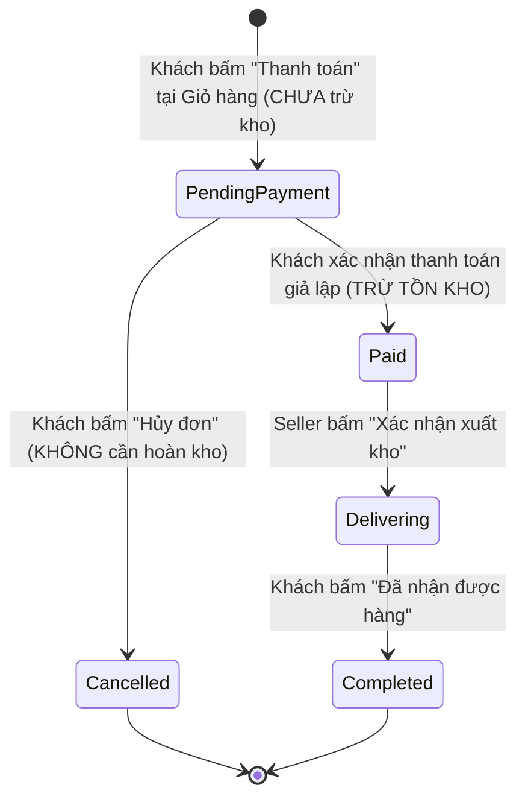

# 📖 TÀI LIỆU HỆ THỐNG & KỊCH BẢN TRẢI NGHIỆM CHI TIẾT (WALKTHROUGH)
## Web Quản Lý Kho Hàng & Đặt Hàng Quần Áo

---

## 1. Danh sách tài khoản thử nghiệm theo từng vai trò

Tất cả các tài khoản mặc định đều có mật khẩu là **`123`**. Hệ thống sử dụng **Email** để đăng nhập.

| STT | Email (Tên đăng nhập) | Mật khẩu | Tên hiển thị (`username`) | Họ và tên | Vai trò (`role`) | Trạng thái | Mục đích kiểm thử |
|:---:|:---|:---:|:---|:---|:---:|:---:|:---|
| 1 | `admin@gmail.com` | `123` | `admin` | Quản Trị Viên | **Admin** | Đang hoạt động | Quản lý sản phẩm, tài khoản người dùng, xem dashboard thống kê doanh thu / tồn kho. |
| 2 | `seller01@gmail.com` | `123` | `seller01` | Thủ Kho Nguyễn Văn A | **Seller** | Đang hoạt động | Xem toàn bộ đơn hàng của khách, xác nhận xuất kho chuyển đơn sang `Delivering`. |
| 3 | `customer01@gmail.com` | `123` | `customer01` | Trần Thị Khách | **Customer** | Đang hoạt động | Mua sắm, giỏ hàng, đặt hàng nhiều sản phẩm, thanh toán giả lập, lịch sử đơn hàng. |
| 4 | `customer02@gmail.com` | `123` | `customer02` | Lê Văn Bình | **Customer** | Đang hoạt động | Khách hàng phụ dùng kiểm tra tính độc lập của giỏ hàng và danh sách đơn. |
| 5 | `customer03@gmail.com` | `123` | `customer03` | Phạm Thị Cúc | **Customer** | **Đã khóa** (`isActive: false`) | **Kiểm thử đăng nhập tài khoản bị khóa** (hệ thống báo từ chối đăng nhập). |

> [!NOTE]
> `username` trong hệ thống chỉ là tên hiển thị, được phép trùng nhau và được phép đổi trong trang cá nhân. Khóa đăng nhập duy nhất là `email`.

---

## 2. Luồng trạng thái đơn hàng & Quy tắc nghiệp vụ

### 2.1 Sơ đồ vòng đời đơn hàng (Order State Lifecycle)



### 2.2 Bảng phân định trạng thái & Quyền thao tác

| Trạng thái | Nhãn hiển thị | Màu Badge | Ai có quyền thao tác? | Hành động khả dụng |
|---|---|---|---|---|
| `PendingPayment` | Chờ thanh toán | Vàng (`warning`) | **Customer** | - **"Thanh toán ngay"**: mở modal thanh toán giả lập.<br>- **"Hủy đơn"**: chuyển đơn sang `Cancelled`. |
| `Paid` | Đã thanh toán | Xanh nhạt (`info`) | **Seller** | - **"Xác nhận xuất kho"**: chuyển đơn sang `Delivering`. |
| `Delivering` | Đang giao hàng | Xanh dương (`primary`) | **Customer** | - **"Đã nhận được hàng"**: xác nhận hoàn tất đơn sang `Completed`. |
| `Completed` | Hoàn thành | Xanh lá (`success`) | Không | Đơn hàng kết thúc chu trình, tính vào doanh thu. |
| `Cancelled` | Đã hủy | Xám (`secondary`) | Không | Đơn hàng đã hủy, không thể thay đổi. |

### 2.3 Quy tắc tồn kho (Stock & Inventory Rules)

1. **Thời điểm trừ tồn kho**:
   - Thêm sản phẩm vào giỏ: **Không** trừ kho.
   - Bấm "Thanh toán" tạo đơn hàng: **Không** trừ kho (đơn ở `PendingPayment`).
   - Chỉ trừ tồn kho khi đơn hàng được thanh toán thành công chuyển sang `Paid`.
2. **Kiểm tra tồn kho tại 3 thời điểm**:
   - **Khi thêm vào giỏ**: Tổng số lượng sản phẩm đó trong giỏ (tính mọi size) + số lượng định thêm không được vượt quá `stock`.
   - **Khi bấm Thanh toán ở giỏ hàng**: Lấy lại dữ liệu mới nhất từ server, nếu sản phẩm bị người khác mua hết hoặc số lượng chọn vượt quá `stock` thì chặn lại và thông báo rõ.
   - **Khi bấm Xác nhận thanh toán ở modal**: Kiểm tra lại tồn kho thực tế, nếu không đủ thì báo lỗi và **giữ nguyên trạng thái đơn là `PendingPayment`**.
3. **Quy tắc gộp sản phẩm nhiều size**:
   - Tồn kho `stock` được tính chung theo mã sản phẩm, không chia riêng theo từng size.
   - Khi thanh toán đơn hàng có cùng sản phẩm ở nhiều size (ví dụ Áo size M x 2 và size L x 1), hệ thống sẽ gộp tổng số lượng (3 cái) rồi mới trừ tồn kho 1 lần.
4. **Quy tắc sản phẩm ngừng kinh doanh (`isActive: false`)**:
   - Không được phép xóa cứng sản phẩm khỏi database để bảo vệ tính toàn vẹn dữ liệu đơn hàng và giỏ hàng cũ.
   - Sản phẩm ngừng bán sẽ bị ẩn khỏi trang chủ và kết quả tìm kiếm của khách.
   - Nếu đã nằm trong giỏ hàng: hiển thị cảnh báo đỏ "Sản phẩm đã ngừng kinh doanh", vô hiệu hóa ô checkbox thanh toán, chỉ cho phép khách bấm nút "Xóa".
   - Nếu đơn hàng đã tạo trước thời điểm sản phẩm ngừng bán: khách vẫn được phép thanh toán bình thường miễn là còn đủ tồn kho.

---

## 3. Kịch bản trải nghiệm từng vai trò (Step-by-Step Walkthrough)

---

### KỊCH BẢN 1: Khách vãng lai (Guest - Chưa đăng nhập)

#### Bước 1.1: Khám phá sản phẩm & Bộ lọc 2 tầng
1. Truy cập trang chủ `http://localhost:3000/`.
2. **Tìm kiếm thời gian thực**: Gõ thử `"áo sơ mi"` hoặc `"den"` vào ô tìm kiếm $\rightarrow$ Danh sách lọc ngay lập tức không cần bấm nút tìm.
3. **Bộ lọc 2 tầng**:
   - Chọn Danh mục chính: **"Áo"** $\rightarrow$ Ô danh mục phụ sẽ xuất hiện các danh mục con tương ứng (Áo sơ mi, Áo phông, Áo polo...).
   - Chọn Danh mục phụ: **"Áo sơ mi"** $\rightarrow$ Chỉ hiển thị áo sơ mi.
   - Đổi danh mục chính sang **"Quần"** $\rightarrow$ Danh mục phụ tự động reset về "Tất cả danh mục phụ".
4. Sản phẩm chỉ hiển thị những mặt hàng đang kinh doanh (`isActive: true`).

#### Bước 1.2: Xem chi tiết sản phẩm & Thử thêm vào giỏ
1. Bấm nút **"Xem chi tiết"** vào sản phẩm bất kỳ (ví dụ: *Áo Sơ Mi Trắng Form Rộng*).
2. Xem thông tin: ảnh lớn, giá tiền VND, mô tả, chất liệu, badge tồn kho, bảng hướng dẫn chọn size S/M/L/XL.
3. Bấm nút **"Thêm vào giỏ hàng"** $\rightarrow$ Hệ thống tự động chuyển hướng đến trang `/login` yêu cầu đăng nhập.

#### Bước 1.3: Thử nghiệm Đăng ký tài khoản mới & Đăng nhập
1. Tại trang đăng nhập, bấm liên kết **"Đăng ký"**.
2. Thử nhập email không đúng định dạng hoặc mật khẩu < 3 ký tự $\rightarrow$ Hệ thống báo lỗi tương ứng.
3. Thử đăng ký với email đã có `admin@gmail.com` $\rightarrow$ Báo lỗi *"Email đã được sử dụng"*.
4. Đăng ký tài khoản hợp lệ:
   - Email: `khachmoi@gmail.com`
   - Tên hiển thị: `khachmoi`
   - Mật khẩu: `123` / Xác nhận: `123`
   - Họ tên, SĐT, Địa chỉ: Điền tùy ý.
5. Bấm **"Đăng ký"** $\rightarrow$ Tự động chuyển về trang `/login` kèm email đã điền sẵn và thông báo thành công.

#### Bước 1.4: Thử đăng nhập tài khoản bị khóa
1. Nhập email: `customer03@gmail.com`, mật khẩu: `123`.
2. Bấm **"Đăng nhập"** $\rightarrow$ Hệ thống chặn lại và hiển thị cảnh báo: *"Tài khoản đã bị khóa, vui lòng liên hệ quản trị viên"*.

---

### KỊCH BẢN 2: Khách hàng mua sắm (Customer - `customer01@gmail.com`)

#### Bước 2.1: Đăng nhập & Mua hàng
1. Đăng nhập với tài khoản:
   - Email: `customer01@gmail.com`
   - Mật khẩu: `123`
2. Hệ thống tự động chuyển về trang chủ, trên thanh Header hiển thị:
   - Menu: **Sản phẩm**, **Giỏ hàng**, **Đơn hàng của tôi**.
   - Góc phải: Ảnh avatar, tên hiển thị `Xin chào, customer01` kèm badge `Customer`.
3. Bấm vào chi tiết sản phẩm *Áo Sơ Mi Trắng Form Rộng*:
   - Nếu chưa chọn size mà bấm thêm $\rightarrow$ Báo *"Vui lòng chọn size trước khi thêm vào giỏ"*.
   - Chọn size **M**, số lượng **2** $\rightarrow$ Bấm **"Thêm vào giỏ hàng"** $\rightarrow$ Báo thành công.
   - Tiếp tục chọn size **M**, số lượng **1** $\rightarrow$ Bấm thêm $\rightarrow$ Số lượng size M trong giỏ tự động cộng dồn thành 3.

#### Bước 2.2: Quản lý giỏ hàng & Thanh toán chung
1. Bấm vào menu **"Giỏ hàng"** trên Header (`/cart`).
2. Tại bảng giỏ hàng:
   - Bấm nút **`+`** hoặc **`-`** để tăng/giảm số lượng từng dòng.
   - Tích chọn hoặc bỏ chọn từng sản phẩm muốn thanh toán $\rightarrow$ Tổng tiền thanh toán bên cột phải tự động cập nhật lại theo thời gian thực.
   - Thử nghiệm sản phẩm ngừng bán: Dòng sản phẩm ngừng bán sẽ có badge đỏ *"Sản phẩm đã ngừng kinh doanh"*, ô checkbox bị vô hiệu hóa, chỉ có thể bấm nút **"Xóa"**.
3. Cột bên phải:
   - Họ tên, SĐT, Địa chỉ được tự động điền sẵn từ profile của khách.
   - Khách có thể sửa lại địa chỉ hoặc SĐT riêng cho đơn này.
4. Bấm nút **"Thanh toán"**:
   - Hệ thống kiểm tra tồn kho mới nhất trên server.
   - Gom tất cả các sản phẩm đã tích chọn vào **1 đơn hàng duy nhất** với trạng thái `PendingPayment`.
   - Các dòng vừa đặt được xóa khỏi giỏ hàng.
   - **Modal thanh toán giả lập** lập tức tự động bật lên.

#### Bước 2.3: Thanh toán giả lập & Trừ tồn kho
1. Trên modal thanh toán:
   - Hiển thị mã đơn hàng và tổng số tiền cần thanh toán.
   - Chọn phương thức: *Chuyển khoản*, *Ví điện tử*, hoặc *Thẻ*.
   - Nếu bấm *"Đóng (Thanh toán sau)"*: Đơn hàng vẫn lưu ở trạng thái `PendingPayment`, khách có thể thanh toán sau.
   - Nếu bấm **"Xác nhận thanh toán"**:
     - Hệ thống kiểm tra lại kho một lần nữa.
     - Tồn kho của các sản phẩm trong đơn được trừ trực tiếp trên `database.json`.
     - Đơn hàng chuyển sang trạng thái `Paid`.
     - Hệ thống chuyển khách đến trang **"Đơn hàng của tôi"**.

#### Bước 2.4: Lịch sử đơn hàng & Thao tác trạng thái
1. Truy cập `/customer/orders` (hoặc bấm menu **"Đơn hàng của tôi"**):
   - Danh sách hiển thị toàn bộ các đơn hàng đã đặt, xếp đơn mới nhất lên đầu.
   - Có ô tìm kiếm theo mã đơn và bộ lọc theo trạng thái.
2. Kiểm tra các nút thao tác:
   - Với đơn `PendingPayment` (Chờ thanh toán): Có nút **"Thanh toán ngay"** (mở lại modal thanh toán) và nút **"Hủy đơn"** (hỏi xác nhận trước khi chuyển sang `Cancelled`).
   - Với đơn `Delivering` (Đang giao hàng): Có nút **"Đã nhận được hàng"** (hỏi xác nhận trước khi chuyển sang `Completed`).
   - Với đơn `Paid`, `Completed`, `Cancelled`: Không có nút thao tác.

#### Bước 2.5: Quản lý thông tin cá nhân & Đổi mật khẩu
1. Bấm vào tên hiển thị trên Header để vào trang `/profile`.
2. **Cập nhật thông tin**:
   - Email hiển thị dạng xám (chỉ đọc, không được sửa).
   - Sửa lại Tên hiển thị, Họ tên, SĐT, Địa chỉ.
   - Đổi ảnh đại diện: Nhập link ảnh URL hoặc bấm nút **"Chọn file ảnh"** từ máy tính (tự động chuyển Base64 và có ô xem trước avatar tròn).
   - Bấm **"Lưu thay đổi"** $\rightarrow$ Header và session lập tức cập nhật thông tin mới.
3. **Đổi mật khẩu**:
   - Nhập sai mật khẩu cũ $\rightarrow$ Báo lỗi.
   - Nhập mật khẩu mới < 3 ký tự hoặc xác nhận không khớp $\rightarrow$ Báo lỗi.
   - Nhập đúng mật khẩu cũ `123`, mật khẩu mới `456` $\rightarrow$ Đổi mật khẩu thành công.

---

### KỊCH BẢN 3: Thủ kho / Nhân viên (Seller - `seller01@gmail.com`)

#### Bước 3.1: Đăng nhập & Điều hướng
1. Đăng nhập với tài khoản:
   - Email: `seller01@gmail.com`
   - Mật khẩu: `123`
2. Hệ thống tự động chuyển hướng thẳng vào trang **"Quản lý đơn hàng"** (`/seller/orders`).
3. Thanh Header của Seller:
   - Không có nút giỏ hàng và trang chủ bán hàng.
   - Chỉ có menu **Quản lý đơn hàng** và **Thông tin cá nhân**.

#### Bước 3.2: Quản lý & Xuất kho đơn hàng
1. Xem danh sách đơn hàng của tất cả khách hàng trong hệ thống.
2. Thử ô tìm kiếm: Gõ tên khách hàng (VD: *"Khách"*, *"Bình"*) hoặc mã đơn (VD: *"ORD1003"*).
3. Lọc theo trạng thái: Chọn lọc đơn `Paid` (Đã thanh toán).
4. **Xác nhận xuất kho**:
   - Tìm đơn hàng có trạng thái `Paid`.
   - Bấm nút **"Xác nhận xuất kho"** $\rightarrow$ Hộp thoại confirm hiện lên hỏi xác nhận.
   - Bấm **OK** $\rightarrow$ Đơn hàng chuyển sang trạng thái `Delivering` (Đang giao hàng) và thời gian `updatedAt` được cập nhật.

---

### KỊCH BẢN 4: Quản trị viên (Admin - `admin@gmail.com`)

#### Bước 4.1: Đăng nhập & Dashboard thống kê
1. Đăng nhập với tài khoản:
   - Email: `admin@gmail.com`
   - Mật khẩu: `123`
2. Hệ thống tự động điều hướng vào trang **Dashboard** (`/admin/dashboard`).
3. Header của Admin gồm: **Dashboard**, **Quản lý sản phẩm**, **Quản lý người dùng**, **Thông tin cá nhân**.
4. **Quan sát 4 chỉ số thống kê**:
   - **Sản phẩm đang bán**: Số lượng các sản phẩm có `isActive: true`.
   - **Sản phẩm sắp hết hàng**: Số lượng sản phẩm có `stock < 5` (bao gồm cả sản phẩm có stock = 0).
   - **Đơn phát sinh trong ngày**: Số lượng đơn được tạo trong ngày hôm nay (tính theo ngày local).
   - **Tổng doanh thu thực tế**: Tổng tiền các đơn có trạng thái `Paid`, `Delivering`, `Completed`.
5. **Bảng sản phẩm sắp hết hàng**: Có ô tìm kiếm theo tên và bộ lọc theo danh mục sản phẩm.

#### Bước 4.2: Quản lý sản phẩm (CRUD) (`/admin/products`)
1. Bấm vào menu **"Quản lý sản phẩm"**.
2. **Tìm kiếm & Bộ lọc**:
   - Tìm kiếm theo tên sản phẩm.
   - Lọc 2 tầng theo danh mục chính và danh mục phụ.
   - Lọc theo trạng thái: Tất cả / Đang bán / Ngừng bán.
3. **Thêm sản phẩm mới**:
   - Bấm nút **"+ Thêm sản phẩm mới"**.
   - Chọn Danh mục chính $\rightarrow$ Danh mục phụ hiển thị các mục con tương ứng.
   - Nhập tên, giá (> 0), tồn kho ($\ge$ 0), chọn các size (S, M, L, XL).
   - Bấm **"Tạo sản phẩm"** $\rightarrow$ Sản phẩm mới xuất hiện ngay với trạng thái mặc định là "Đang bán".
4. **Chỉnh sửa sản phẩm**:
   - Bấm nút **"Sửa"** tại sản phẩm bất kỳ.
   - Chỉnh sửa giá hoặc cập nhật lại số lượng tồn kho.
   - Bấm **"Lưu thay đổi"** $\rightarrow$ Dữ liệu cập nhật ngay lập tức.
5. **Ngừng bán / Mở bán lại (Không xóa thật)**:
   - Bấm **"Ngừng bán"** tại 1 sản phẩm đang bán $\rightarrow$ Hộp thoại xác nhận $\rightarrow$ Sản phẩm chuyển sang badge xám *"Ngừng bán"*.
   - Khách hàng ở trang chủ sẽ lập tức không còn nhìn thấy sản phẩm này nữa.
   - Bấm **"Bán lại"** $\rightarrow$ Sản phẩm chuyển về badge xanh *"Đang bán"*.

#### Bước 4.3: Quản lý người dùng (`/admin/users`)
1. Bấm vào menu **"Quản lý người dùng"**.
2. Bảng hiển thị đầy đủ: Ảnh đại diện, Email, Tên hiển thị, Họ tên, SĐT, Vai trò, Trạng thái hoạt động, Cột hành động.
3. **Tìm kiếm & Lọc**:
   - Tìm kiếm real-time theo email, username, hoặc họ tên.
   - Lọc theo vai trò (Admin, Seller, Customer) và trạng thái (Đang hoạt động, Đã khóa).
4. **Thêm tài khoản người dùng mới**:
   - Bấm **"+ Thêm tài khoản mới"**.
   - Có thể chủ động chọn Role là Admin, Seller, hoặc Customer.
   - Kiểm tra định dạng email và không cho phép trùng email.
5. **Cơ chế bảo vệ tài khoản Admin**:
   - Với tất cả tài khoản có `role = "Admin"`, các nút *Reset MK*, *Đổi role*, *Khóa/Mở khóa* đều bị **vô hiệu hóa (disable)** hoàn toàn.
   - Cột hành động hiển thị dòng chữ: *"Không thể thao tác với tài khoản Admin"*.
6. **Thao tác với tài khoản thông thường (Customer / Seller)**:
   - **Reset MK**: Bấm "Reset MK" $\rightarrow$ Xác nhận $\rightarrow$ Mật khẩu của tài khoản đó được đặt lại về `123`.
   - **Đổi role**: Bấm "Đổi role" $\rightarrow$ Modal chọn role mới (ví dụ nâng Customer lên Seller hoặc Admin) $\rightarrow$ Bấm lưu.
   - **Khóa / Mở khóa**: Bấm "Khóa" $\rightarrow$ Tài khoản chuyển sang trạng thái "Đã khóa" và không thể đăng nhập được nữa. Bấm "Mở khóa" để kích hoạt lại.

---

## 4. Hướng dẫn khởi chạy dự án

### Cửa sổ Terminal 1: Chạy Fake API Server (Port 9999)
```bash
npm run server
```
*(Lệnh tương đương: `npx json-server database.json --port 9999`)*

### Cửa sổ Terminal 2: Chạy React Frontend (Port 3000)
```bash
npm start
```
Trình duyệt sẽ tự động mở trang web tại địa chỉ: `http://localhost:3000/`.

